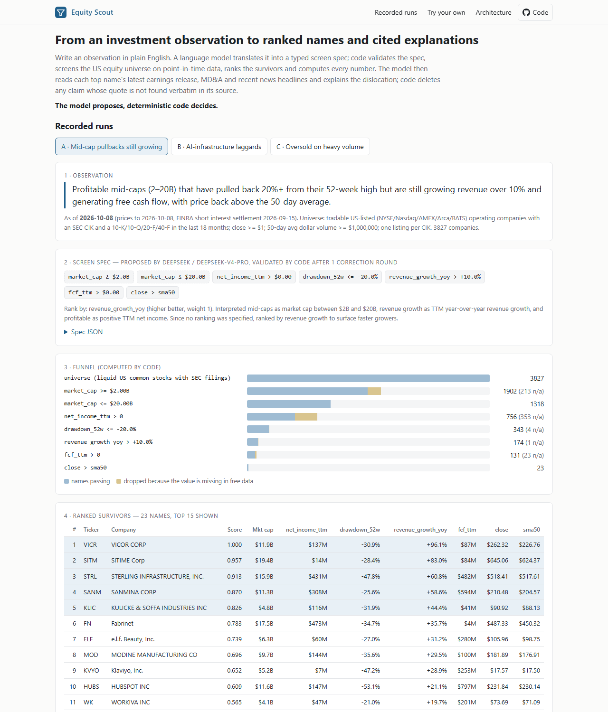
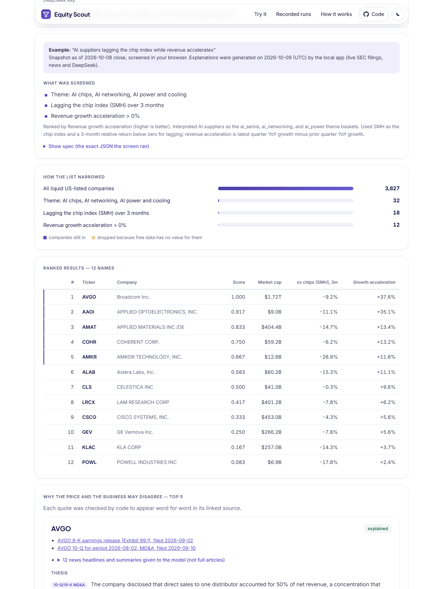
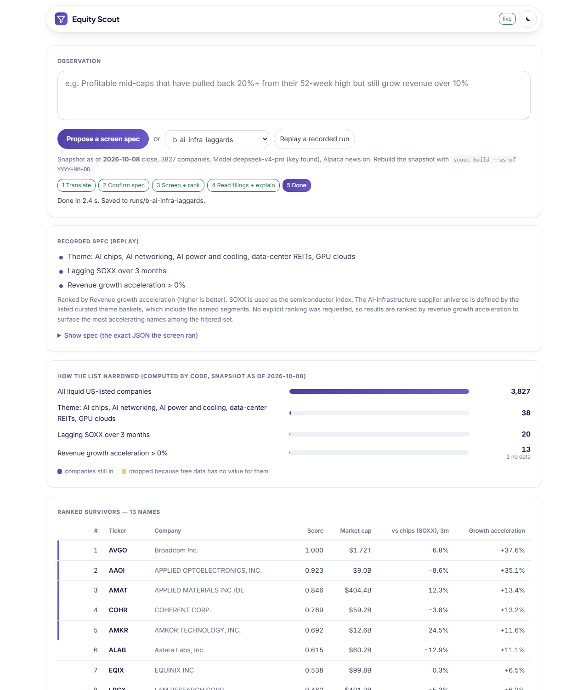

# equity-scout

Write an investment observation in plain English, for example *"profitable mid-caps that have pulled back 20%
from their highs but are still growing revenue over 10%"*. A language model translates it into a typed,
whitelisted screen spec. Code validates the spec, screens about 3,800 US-listed operating companies on
point-in-time data, ranks the survivors and computes every number. **Every screen is then backtested
automatically**, monthly since 2023 on point-in-time panels, before anything else is shown, and a team of
independent AI and rule-based investors votes on the names (see *The investor team*). For the top names, the model reads the latest
earnings release, the 10-Q/10-K MD&A and recent news headlines, then explains why the stock and the fundamentals
might disagree. Code deletes any claim whose quote does not appear verbatim in its source.



## Try it

**In the browser, nothing to install:** open the site
([henryzhangpku.github.io/equity-scout](https://henryzhangpku.github.io/equity-scout/), or `docs/index.html` from disk).

* **One-click examples** sit just under the headline: plain-English ideas a trader would write ("Oversold large
  caps on heavy volume", "AI suppliers lagging the chip index while revenue accelerates", and others). Each was
  translated by the model once and checked by code. Its spec, prompt and response are in `llm_cache/` and the full
  run is in `runs/chip-*`. Clicking an example re-runs the screen in the page on the 2026-10-08 snapshot and shows
  the cited explanations the local pipeline wrote for its top names, labelled with the run date. No key is needed.
* **Daily and weekly together:** one more example, *"RSI under 30 on the daily, MACD crossing above its signal on
  the weekly, volume above its 20-day average"*, runs in the page with no model. It shows the honest result (0
  names on 2026-10-08) and a one-click "Loosen RSI to 45" variant that returns its names, with a note on VXX, an
  exchange-traded note that slips into the universe.
* **Every result shows its backtest and the team's vote:** under the ranked names, the backtest runs on its own,
  then the investor team's recorded vote (12 investors, each with its own data; every reason checked by code).
* **The team's own ideas come first, no typing needed:** the top of the page shows the ideas the investor team
  brought itself in the latest brief (`runs/brief-2026-10-08`), each with its backtest and the names the team backs.
  One click opens the idea: the screen re-runs in the browser, then its full backtest and the team's vote. The
  *Morning brief* section lists the same ideas and every rejected one with the reason.
* **Floating ask bar:** available anywhere on the page. Enter asks, Shift+Enter adds a line, `/` or Ctrl/Cmd+K
  focuses it; on focus it offers the one-click examples, which answer instantly even when live analysis is offline,
  and it shows whether live analysis is up.
* **Learning loop:** a section built from the recorded loop ledgers (`docs/data/loop.js`, written by `scout site`,
  checked by a test against the ledgers): the five steps, the fixed split and costs, every hypothesis with its
  excess after costs, t, p, the corrected bar and the decision, and the model-proposed ideas.
* **Ask your own question.** When the hosted API is reachable (its URL is set in `docs/config.js`), the box sends
  the question to it. The model proposes a screen, you see it in plain English and confirm, code runs it, and
  explanations arrive name by name. The status pill reads *Live* or *Snapshot (offline)*. If the API is down,
  capped or not configured, the page says so and the examples keep working.
* **Advanced** (collapsed): a spec editor limited to whitelisted fields, plus bring-your-own-key translation.
  The key stays in memory and goes only to the configured LLM provider's endpoint.
* Everything a visitor reads is in plain English: "Down at least 20% from 52-week high", "Free cash flow, last 12
  months > $0". Raw field names appear only under *Show spec*.
* The screen, funnel and ranking in the page come from `docs/scout-core.js`, a line-by-line port of the Python code.
  A parity test runs every recorded spec, including each example, through both implementations and requires
  identical funnels and rankings. The snapshot is 5.4 MB raw and about 2.2 MB gzipped, and loads on first use.
* Light and dark themes follow the system setting. A toggle in the nav overrides it, and the choice is remembered
  when browser storage works.



**Locally, for live demos:** `uv run scout serve` opens `http://127.0.0.1:8765/`. Type an observation and the model
proposes a spec. After you confirm, the full pipeline runs on the latest snapshot plus live EDGAR filings and Alpaca
news, and cited explanations stream in one name at a time.

* *Replay a recorded run* needs no network.
* `--offline` answers only from recorded material.
* Picks go into the hash-chained ledger only when you click **Record**.



## The rule: the model proposes, deterministic code decides

| Step | Model | Code |
|---|---|---|
| Translate | fills a JSON spec from the observation | validates every key, field, operator, unit and threshold against a whitelist; refuses anything else with a reason; one correction round, then the run stops |
| Screen | nothing | applies the conditions in order and records, for each step, how many names entered, passed, failed and lacked data |
| Rank | nothing | weighted mean of percentile ranks; ties go to market cap, then ticker |
| Explain | writes claims, each with a quote and a document id | keeps a claim only if the quote is found verbatim in that document (only whitespace, curly quotes and dashes are normalised) and every number in the claim also appears in the quote; with fewer than two surviving thesis claims the verdict is *not enough evidence* |

Anything the schema cannot express (analyst downgrades, guidance, sentiment) goes in `unmapped` and is shown
as **not screened**. It is never silently dropped or approximated. Every prompt and response is stored in
`llm_cache/`, so the recorded runs replay offline with no API key.

## Architecture

```mermaid
flowchart LR
  OBS["Observation<br/>(plain English)"] --> T["LLM: translate"]:::llm --> SPEC["Spec (JSON)"]
  SPEC --> V["Validate<br/>(whitelist)"]:::code --> SCR["Screen"]:::code --> R["Funnel +<br/>ranked table"]:::code --> BT["Backtest<br/>(always, monthly since 2023)"]:::code --> TEAM["Investor team votes<br/>(each separately; reasons checked by code)"]:::llm --> TOP["Top N"]
  PAN[("Point-in-time<br/>monthly panels")] --> BT

  subgraph SNAP["Feature snapshot (point-in-time)"]
    direction TB
    A["Alpaca bars → indicators"]
    C["SEC companyfacts → TTM / growth / FCF / EV"]
    S["SEC submissions → SIC, filing list"]
    F["FINRA short interest"]
  end
  SNAP --> SCR

  TOP --> DOCS["EDGAR 8-K ex.99.1,<br/>MD&A, news headlines"] --> W["LLM: write claims"]:::llm --> CV["Citation validator<br/>(verbatim quote + numbers)"]:::code --> REP["Report"]

  classDef llm fill:#fde68a,stroke:#b45309,color:#000
  classDef code fill:#bbf7d0,stroke:#15803d,color:#000
```



Amber steps are the model; green steps are deterministic code.

Every data layer sits behind a small interface in `src/scout/data/base.py`, so a licensed source can replace the
free one without touching the screen, the ranking or the validator.

| Layer | This demo (free) | Institutional equivalent | What the free version lacks |
|---|---|---|---|
| Universe + prices | Alpaca assets + daily SIP bars, split and dividend adjusted (`data/alpaca.py`) | Bloomberg BQL / BQuant, LSEG, S&P Capital IQ | survivorship-free history, delisted names, intraday data |
| Fundamentals | SEC XBRL companyfacts, each fact gated by its `filed` date (`data/sec.py`, `fundamentals.py`) | BQL fundamentals, Capital IQ / Compustat point-in-time | IFRS filers, standardised line items, segments, consensus estimates and revisions |
| Classification | SEC SIC codes in named groups, plus a few curated theme baskets defined in code | GICS, BICS, TRBC, vendor theme baskets | real theme membership |
| Short interest | FINRA consolidated short interest, twice monthly (`data/finra.py`) | securities-lending feeds | float-based %, daily data, borrow cost |
| Documents | EDGAR 8-K Exhibit 99.1 and 10-Q / 10-K MD&A (`data/edgar_docs.py`) | document search on the same terminals | earnings-call transcripts (interface kept, `NoTranscripts`) |
| News | Alpaca news API (Benzinga): headline and summary only, cut at the as-of close (`data/news.py`) | Bloomberg / LSEG / Dow Jones news | full articles, broad sources |
| LLM | an LLM (configurable; a default provider and one alternative) through one OpenAI-compatible client (`llm.py`) | a frontier model inside the firm's controls | nothing structural |

### Point-in-time rules

* A fundamental fact is visible only on or after its `filed` date. When a period is restated, the restated value
  stays hidden until it is filed.
* Quarters are taken as reported or derived from year-to-date facts within a single XBRL concept (Q4 = FY − 9M).
  Cash-flow items are mostly reported year-to-date, so this derivation is what makes TTM free cash flow possible.
* If the latest quarter ended more than 220 days before the as-of date, the fundamentals are left missing. They are
  never carried forward.
* Short interest is visible 8 business days after its settlement date. News is visible only if it was published
  before 16:00 New York time on the as-of date.
* The SEC frames API was evaluated and not used for values. A frame returns the *latest-filed* number for each
  period and has no `filed` date, so a restatement would leak into the past (`data/sec.py` explains this).

## Data sources: swap one class

The screen, the ranking and the citation check never call a data vendor. They read a feature snapshot, and the
snapshot is built from classes that implement the small Protocols in `src/scout/data/base.py` (`PriceSource`,
`FundamentalSource` and the others). Changing vendor means writing one class with the same methods and the same
point-in-time rule; nothing downstream changes.

| Source | In this repo | Key needed | What it provides |
|---|---|---|---|
| Alpaca + SEC (default, free) | `data/alpaca.py`, `data/sec.py` | free Alpaca keys for prices; none for SEC | universe, split- and dividend-adjusted daily bars; point-in-time fundamentals |
| OpenBB (open source, many providers, some keyless) | `data/openbb_source.py`, optional extra | none: `yfinance` for bars, `sec` for the ticker list | universe and adjusted daily bars behind `PriceSource`; fundamentals stay on SEC |
| Licensed terminal or feed (Bloomberg BQL / BQuant, LSEG, S&P Capital IQ) | not included | a license | any layer, written as one class behind the same Protocol |

Terminal data is generally licensed for use on the terminal itself, so an automated loop like this one may need a
separate data feed or license.

The OpenBB class returns the same frame as the Alpaca one (date, symbol, open, high, low, close, volume, split- and
dividend-adjusted, sorted by symbol and date) and drops any bar dated after the as-of date, whatever the provider
sends. Fundamentals stay on SEC companyfacts either way: the OpenBB providers that serve financial statements
(fmp, intrinio, polygon, tiingo) need a key and do not gate values by filing date. yfinance reads Yahoo Finance's
public endpoints; check their terms before any commercial use.

```bash
uv sync --extra openbb                                    # OpenBB Platform v4 (openbb>=4.4,<5)
uv run scout build --as-of 2026-10-08 --prices openbb    # or set SCOUT_PRICES=openbb
```

Without the extra installed, `--prices openbb` stops with a one-line install hint. The first `import openbb` builds
its extension index, which takes a few minutes once.

### Multi-timeframe technicals

Snapshots built from now on also carry weekly and short-window fields: `rsi14_w` (RSI of weekly closes),
`macd_hist_w` and `macd_cross_up_w` (weekly MACD and a cross above its signal in the latest week), `macd_cross_up`
(the same on daily bars) and `volume_ratio_20d`. Weeks end on Friday, and the current week ends at the as-of close,
so a mid-week snapshot uses a partial week and nothing later. A sentence such as *"RSI under 30 on the daily, MACD
crossing above its signal on the weekly, and volume above its 20-day average"* maps to `rsi14 < 30`,
`macd_cross_up_w == true`, `volume_ratio_20d > 1`.

* The translation prompt that knows these fields is version 3: `scout spec "..." --prompt-version 3`. The default
  stays version 2, so every recorded run and example replays unchanged.
* The committed 2026-10-08 snapshot was built before these fields existed. They were added afterwards from the
  snapshot's own cached daily bars (SHA-256 checked against its manifest), with no network, by
  `snapshot.add_technicals`, which first reproduces all 84 technical fields already in the snapshot exactly. They
  live in a sidecar, `data/snapshots/2026-10-08/features-added.csv.gz` (provenance in `features-added.json`),
  joined on symbol at load time, so `features.csv.gz` and `manifest.json`, whose hashes the recorded runs cite,
  are byte-identical and every recorded run replays unchanged.
* On that snapshot the sentence above passes 0 names: 333 have daily RSI under 30, none of them crossed up on the
  weekly MACD (10 lack enough weekly history). With RSI under 45 instead, 3 pass (VXX, ERII, SOC).
  `uv run scout screen spec.json` runs a spec file with no model and no network.
* The backtest panels predate these fields; a backtest that uses them is refused with a message saying so. The
  browser snapshot in `docs/data/` carries them (about +70 KB gzipped), and the parity test runs the strict and
  loosened specs above through both the Python and the browser screen.

## Recorded runs (real data as of 2026-10-08 close)

| Run | Funnel (names left after each step) | Top names |
|---|---|---|
| A: profitable mid-caps, 20%+ below the 52-week high, revenue growth > 10%, FCF positive, back above the 50-day | 3827 → 1902 → 1318 → 756 → 343 → 174 → 131 → **23** | VICR (not enough evidence), SITM, STRL, SANM, KLIC |
| B: AI-infrastructure suppliers lagging the semiconductor index (SOXX) over 3 months with accelerating revenue growth | 3827 → 38 → 20 → **13** | AVGO, AAOI, AMAT, COHR, AMKR |
| C: large caps with RSI < 35 on 1.5x volume, 50-day still above the 200-day, FCF positive, short interest < 5%; "no recent analyst downgrades" refused as unmapped | 3827 → 872 → 86 → 29 → 14 → 3 → **2** | BX, SBUX |

Each run folder in `runs/` holds `run.json` (spec, translation attempts, funnel, every ranked row, explanations,
data manifest with SHA-256 hashes), `report.md`, and `docs/`, which contains the exact document text the model
was shown, so each citation can be checked by hand.

The universe in run B comes from curated baskets (`THEMES` in `spec.py`). SIC codes cannot separate data-center
REITs from other REITs or find neoclouds at all, and with SIC alone the top of the list was micro-caps. The
baskets are a fixed list in code, open to review, and the model can only choose among them.

### Sectors and industry groups

Screens can filter by 11 investor sectors (Communication Services through Utilities) and 45 industry groups, for
example Software, Semiconductors, Banks, Insurance, Biotech, Pharma, Medical Devices, Retail, Restaurants, Apparel &
Luxury, Food & Beverage, Household & Personal Products, Autos, Aerospace & Defense, Oil & Gas, REITs, Media &
Entertainment and Telecom.

* The mapping lives in `src/scout/sectors.py` and is versioned (`MAPPING_VERSION`). It is published with coverage,
  every rule, the overrides and known misfits at [docs/sectors.html](https://henryzhangpku.github.io/equity-scout/sectors.html).
* Each sector comes from the company's SEC SIC code. Rules are ordered, so specific codes win over broad ranges.
* 32 ticker overrides fix large misfits, each with a one-line reason. Examples: Alphabet and Meta (SIC 7370)
  move to Interactive Media; Visa and Mastercard (7389) move to payments; LRCX (3559) moves to Semiconductors.
* Coverage: 3,786 of the 3,827 names (98.9%) get a sector. The rest have no usable SIC and count as "no data" in the
  funnel.
* This is not the licensed GICS classification.

The `sectors` and `industry_groups` universe filters are whitelisted and validated in Python and in the browser core,
with parity tests. The translation prompt (version 2) maps phrases like "consumer brands", "banks", "defense names",
"chip companies" and "pharma" to them. Recorded runs keep replaying with the frozen version-1 prompt, and the older
SIC `industries` filter still works. Results show a Sector column and a survivors-by-sector breakdown.

### One-click examples (same snapshot; explanations generated 2026-10-09 UTC)

| Example | Funnel | Top names |
|---|---|---|
| Quality consumer brands down 30%+ with strong free cash flow | 3,827 → 177 → 64 → 9 | DECK, HSY, WING, COCO, CELH |
| Profitable names over $2B, down 30%+ and still growing | 3,827 → 1,902 → 1,120 → 239 → 205 → 163 | CTVA, TTD, LQDA, Z, CSGP |
| AI suppliers lagging the chip index while revenue accelerates | 3,827 → 32 → 18 → 12 | AVGO, AAOI, AMAT, COHR, AMKR |
| Oversold large caps on heavy volume | 3,827 → 872 → 35 → 7 | EMA, ARGX, NLY, DOC, HRL |
| Cash-rich small caps down 40%+ from their highs | 3,827 → 3,060 → 1,158 → 389 → 111 → 31 | OPFI, COLL, YELP, TDOC, CRMD |
| Heavily shorted, profitable, back above the 50-day average | 3,827 → 1,633 → 28 → 6 | WOLF, KSS, CBRL, MNRO, SWKS |
| Fast growers over $2B beating the S&P 500 | 3,827 → 1,902 → 206 → 106 → 66 | BMNR, VAL, IBRX, MU, TARS |

## Backtest this screen

Every screen is backtested, automatically, as the step right after the screen: an example, a recorded run, a
live-translated one, or one built under Advanced. There is no button to press. A screen without its history says
little, so the backtest appears directly under the ranked results and before any explanation, and `scout run` writes
it into `run.json` and `report.md`. The model plays no part; this is pure code (`src/scout/backtest.py`). When a
screen uses fields the panels do not hold, the page says *Not backtested* and why, instead of guessing.

* **Point-in-time monthly panels** (`scout build-panels`, `src/scout/panels.py`): 45 month-end rebalances, from
  2023-01-31 to 2026-09-30 (44 holding months).
  * Each panel holds the feature set as it was knowable on that date: prices up to the date, fundamentals from facts
    filed on or before it, short interest from the latest FINRA settlement visible then, and the liquidity rule
    applied as of that date.
  * Price history runs from Alpaca back to 2021-12, so the 12-month indicators exist from the first rebalance.
  * Storage is one compressed NumPy archive, `data/panels/panels.npz`, 32.6 MB, float32, shipped in the image.
  * The build takes about 34 minutes cold, almost all of it fundamentals (about 25) and FINRA. The price fields take
    5 seconds with the `fast` extra (`uv sync --extra fast`, Numba: one compiled pass over all 3,827 symbols that
    evaluates only the kept rows) and about 6 minutes without it (pandas, one symbol at a time). The two agree on
    all 6.3 million price values (`tests/test_fastpanel.py` checks every session of a synthetic panel).
  * Relative strength against the sector ETFs is left out to keep the file small. Screens that use it are refused
    with a message.
  * A check slice built on the snapshot date gives the same screens as the live snapshot (parity test).
* **Engine.** At each rebalance it screens, ranks, and holds the top N (the spec's `top_n`) equal-weight until the
  next month end.
  * Returns come from adjusted closes. A name without a bar on the next date exits at its last close, and this is
    counted.
  * Costs are 10 bps per side on turnover.
  * Benchmarks: SPY, and the equal-weight universe (universe filters only, no conditions).
* **Stats:** growth of $1 for all three, CAGR, volatility, Sharpe (rf = 0), max drawdown, hit rate vs SPY,
  average names held, turnover, months with too few names (held as cash), and exits at a last close.
* **Gates**, all required: the monthly excess over SPY must be positive (a) on average after costs, (b) in the
  first half and (c) the second half, (d) with the best month removed, and (e) at double costs. There must also be
  at least 18 months holding 3 or more names. Verdict: *Edge on this history* / *No edge* / *Not enough data*,
  always described as evidence on a short history, not proof.
* **Caveats shown with every result:**
  * survivorship (only today's listed companies);
  * the short history;
  * the point-in-time rules followed;
  * no news and no model;
  * today's SIC sectors applied to the past;
  * fields that are mostly missing historically;
  * for theme baskets, a look-ahead warning: they were picked in 2026, knowing the AI winners.
* **Where it runs:**
  * `POST /api/backtest {spec}` on the hosted API, rate-limited separately (20 per IP per hour, 400 per day), called
    by the page as soon as a live screen returns;
  * the local app, as soon as the screen event arrives;
  * `scout run` (step 4 of `report.md`, before the explanations) and `scout backtest runs/<run>` from the CLI;
  * on the static site, saved backtests for every example and recorded run (`docs/data/backtests.js`), plus live
    backtests for new screens when the API is up.

| Screen | Verdict (gates floor,a,b,c,d,e) | Screen / universe / SPY, total 2023-01 to 2026-09 |
|---|---|---|
| Quality consumer brands down 30%+ | No edge (✓✗✗✗✗✗) | -2% / -6% / +97% |
| Profitable names over $2B, down 30%+ | No edge (✓✗✗✓✗✗) | +19% / +38% / +97% |
| AI suppliers lagging the chip index | Edge on this history (all ✓), **look-ahead biased** | +844% / +903% / +97% |
| Oversold large caps on heavy volume | No edge (✓✗✗✗✗✗) | -68% / +37% / +97% |
| Cash-rich small caps down 40%+ | Edge on this history (all ✓) | +124% / +60% / +97% |
| Heavily shorted, profitable, above the 50-day | No edge (✓✗✓✗✗✗) | 0% / +58% / +97% |
| Fast growers over $2B beating the S&P 500 | No edge (✓✗✗✗✗✗) | -15% / +38% / +97% |

## The investor team

One chat can play "a value investor, then a momentum trader", but it is one model in one conversation, so the
views stay correlated. Here a team of independent investors (`src/scout/roster.json`, code in `src/scout/team.py`)
votes on every screen and brings ideas of its own. The model proposes; code decides.

* **Each investor is a config row:** a style, a data diet (the only fields it is shown, so investors see different
  information) and either a model prompt (`llm`, one separate call per investor) or a fixed rule (`code`, no model).
  The shipped roster has 8 model investors (deep value, quality compounder, growth at a reasonable price, trend
  follower, contrarian, forensic skeptic, short-squeeze hunter, small-cap specialist) and 4 rule investors
  (momentum, value, quality, reversal). Investors are styles, not people. Adding one is one row.
* **A vote is checked like a citation.** Conviction runs from -1 to +1 (0 = abstain). Every reason must name a
  field from that investor's diet and repeat its value exactly as shown, and every number in it must be one of the
  values shown; code deletes any reason that fails, and a vote with no surviving reason counts as an abstention.
  A rule investor votes by its rule: a name that passes gets 1.0 (best ranked) down to 0.5.
* **Votes are counted, not averaged by mood.** Each investor is weighted by its record, and investors whose past
  votes correlate at 0.8 or more count as one voice. The team leans *for* or *against* only with at least two
  independent voices and a weighted conviction of 0.25 or more; a real disagreement (the minority is at least a
  third) is shown as *split*.
* **Every investor has a record.** All votes go into `runs/votes.jsonl` (hash-chained like the pick ledger).
  `scout team` marks each vote to market once its horizon has passed: hit rate on excess return over SPY, mean
  conviction-weighted excess, t-stat and rank IC, and writes `runs/scorecards.json`, whose weights the next vote
  uses. The forward record sets an investor's weight after 10 matured votes; before that a rule investor starts
  from its rule's 44-month backtest and a model investor at 1.0 ("no record yet"). A vote recorded more than 3
  days after its as-of date is never scored.
* **Mode 1, an idea is tested.** `scout run` now goes screen → backtest → the team's vote → explanations, and the
  local app shows the vote under the backtest. `scout vote runs/<run>` votes on a recorded run. The hosted API does
  not run the team (cost); the local app and the CLI do.
* **Mode 2, the team brings ideas (`scout brief`).** Each proposing investor writes one screen in its style (a
  rule investor proposes its rule). Code validates it, screens today's snapshot and backtests it with the same
  gates as every screen. Only an idea with *Edge on this history* and names to hold today is accepted; the team
  then votes on its names. `runs/brief-<date>/brief.md` lists the accepted ideas and every rejected one with its
  reason. Every proposal goes into `runs/proposals.jsonl`; a model investor's rejected idea is dead and is not
  tested again. For a 7am brief, schedule it: `0 7 * * 1-5 cd equity-scout && uv run scout build --as-of today && uv run scout brief`.

```bash
uv run scout team                       # each investor's record, rule backtest and weight
uv run scout vote runs/a-midcap-pullback # the team votes on a recorded run (add --code-only for no model calls)
uv run scout brief                      # the team proposes; code screens, backtests, votes; morning brief
```

## A learning loop that cannot fool itself

A loop where each test result shapes the next test: try RSI overbought, find it weak, try divergence, add MACD,
learn which combination fits. The risk in such a loop is that it keeps trying until something looks good by chance.
So the agents only propose; a fixed evaluator decides (`scout loop`, code in `src/scout/loop.py` and
`src/scout/propose.py`).

```
propose a signal spec ──▶ validate ──▶ evaluate on discovery ──▶ correct for the number of tries ──▶ record ──▶ decide
        ▲                                     │ passes?                                              (hash-chained ledger)
        └──── discovery results only ◀────────┘ then, and only then, open the sealed out-of-sample period once
```

* **Propose.** A proposer writes a typed, whitelisted JSON spec: entry conditions on daily or weekly RSI(14), MACD
  histogram sign, MACD crosses and RSI divergence, for a long side and/or a short side, and a holding period of 5, 10
  or 20 days. `--proposer scripted` is deterministic: RSI overbought, RSI oversold, RSI divergence, each again with a
  MACD cross and with the MACD histogram sign, then the best branch so far refined once. `--proposer llm` lets the
  model read the ledger and propose the next spec; code validates it, an invalid one is recorded and counts as a try,
  and prompts and responses are cached in `llm_cache/`.
* **Evaluate on a fixed split.** The split was set in code before any hypothesis ran: discovery is every signal whose
  holding period ends by 2024-12-31; out-of-sample is every signal from 2025-01-01. A signal on a close enters at the
  next close. Each event earns its forward return minus the universe's mean forward return over the same window,
  minus 20 bps round trip. The evaluator reports hit rate, signal return against the universe baseline, a t-stat
  (block means, Newey-West) and a Sharpe-like ratio.
* **Correct for the number of tries.** Bonferroni: the step budget K is declared before the run and every step counts,
  so each test needs one-sided p < 0.05 / K, in discovery and again out-of-sample.
* **Record and decide.** Promote only if discovery passes and then out-of-sample passes. Out-of-sample is opened only
  for an idea that already passed discovery, and the proposer never sees it, not even whether it was opened (a test
  changes the out-of-sample prices and checks that every proposal and prompt stays identical). Every step, with the
  spec, the numbers, the decision and the reason, goes into a hash-chained `ledger.jsonl`. A repeat of a tested spec
  is rejected without touching the data, so dead ideas stay dead.

**Where it runs.** On your own compute, against a stored snapshot: `data/loop/daily_closes.npz` (1.8 MB, daily
adjusted closes for the 500 most liquid companies as of 2022-02-28, built from the cached Alpaca bars with
`scout loop-data`, SHA-256 recorded in each ledger). A run of ten hypotheses takes a few seconds on a laptop; the
model calls are the only network traffic, and only in llm mode. Every recorded run can be re-run from the ledger
and gives the same numbers (a test does this, offline). The history is under five years: 2021-12-01 to 2026-10-08.

```bash
uv run scout loop --proposer scripted --max-steps 10     # writes runs/loop-<date>/: ledger.jsonl, report.md, summary.json
uv run scout loop --proposer llm --max-steps 5           # needs the LLM key, or --offline to replay recordings
```

**The recorded scripted run** (`runs/loop-2026-10-12/`, K = 10, bar p < 0.005): nothing survived. All ten
hypotheses lost money against the universe after costs in discovery, so the out-of-sample period was never opened.

| Hypothesis (10-day hold) | Discovery events | Excess after costs | t |
|---|---|---|---|
| Short RSI > 70 | 26,084 | -0.48% | -0.33 |
| Long RSI < 30 | 15,017 | -0.23% | -1.20 |
| RSI divergence, both sides | 5,749 | -0.12% | -0.79 |
| Overbought + MACD cross down / + histogram below zero | 2,360 / 1,710 | -0.41% / -0.23% | -0.16 / -1.04 |
| Oversold + MACD cross up / + histogram above zero | 1,452 / 1,504 | -0.19% / -0.10% | -1.36 / -0.30 |
| Divergence + MACD cross / + histogram sign | 2,389 / 3,637 | -0.18% / -0.21% | -1.08 / -0.55 |
| Best branch refined (overbought + cross, RSI > 75) | 919 | -0.47% | -1.26 |

In plain words: on 2022 to 2024 data, overbought names kept rising and oversold names did no better than the
market, net of costs. Adding a MACD filter made overbought and oversold less negative and divergence more negative,
which is the shape of the story above, but every variant still lost money and no variant has |t| above 1.4, so the
differences between them are noise. A loop without the correction and the sealed period would be free to keep slicing until one of
these crossed p < 0.05. This one recorded ten rejections, and the out-of-sample years are still unused for the next
idea. The recorded llm run (`runs/loop-2026-10-12-llm/`, K = 5) tried five of the model's own ideas, including a
weekly divergence variant; none had a positive excess in discovery.

## Forward tracking

Every live run appends its top names and entry closes to `runs/picks.jsonl`. The file is append-only and
hash-chained: each entry stores the SHA-256 of its own content and the hash of the entry before it, so editing or
deleting a past entry is detected. `scout track` checks the chain and marks every entry to market against SPY and
SMH using fresh Alpaca closes. The site shows the result under the label **"since run date; days of history, not
evidence"**. As of the recording date every entry has 0 trading days of history.

## Use it from any model (MCP)

MCP (Model Context Protocol) is an open standard that lets a model call tools served by another program.
`scout mcp` serves equity-scout's deterministic parts as MCP tools over stdio, so Claude Code, Claude Desktop or
any other MCP client can drive the screen. The model on top can be swapped, and so can the data vendor underneath
(see *Data sources* above); the validator, screen, ranker and citation checks in the middle stay the same.

| Tool | What it returns |
|---|---|
| `list_fields()` | every whitelisted field with kind, units and description, and whether the latest snapshot has it; operators, sectors, industry groups, themes and the spec shape |
| `validate_spec(spec)` | ok, or every problem with its reason (the same validator the CLI uses) |
| `run_screen(spec, as_of=None)` | the funnel (entered, passed, failed, no data per step), the survivor count and the top N ranked names with the computed values, on a committed snapshot (default the latest); invalid specs and fields the snapshot lacks are refused with reasons |
| `explain(symbol, run_id=None)` | the recorded cited explanation for a name: claims with their verified quotes and source URLs; if none is recorded it says so |
| `loop_report(run_id="loop-2026-10-12")` | the recorded learning-loop summary: each hypothesis, its discovery metrics, decision and reason, whether out-of-sample was opened, and whether the ledger chain is intact |

There is no translate tool. Writing the spec is the client model's job: it reads `list_fields` and fills the
structure, and `validate_spec` holds it to the same whitelist the built-in translator is held to. The built-in
translator needs a provider key or a recorded response, so it stays in `scout run` and `scout serve`.

Connect it (the SDK is an optional extra, `uv sync --extra mcp`):

```bash
# Claude Code, from the repo folder
claude mcp add equity-scout -- uv run --extra mcp scout mcp
```

```json
{
  "mcpServers": {
    "equity-scout": {
      "command": "uv",
      "args": ["run", "--directory", "/path/to/equity-scout", "--extra", "mcp", "scout", "mcp"]
    }
  }
}
```

The JSON goes in Claude Desktop's `claude_desktop_config.json`. `python -m scout.mcp_server` also starts the server.

An example exchange, in words. You ask for "AI suppliers lagging the chip index while revenue accelerates". The
model calls `list_fields`, sees the `ai_semis`, `ai_networking` and `ai_power` themes and the fields
`rs_3m_vs_smh` and `revenue_growth_accel`, and writes a spec with two conditions ranked by acceleration. It calls
`validate_spec`; had it written a percent such as `25` where a ratio field takes the decimal `0.25`, the validator
would say the value looks like a percent and the model would fix it. `run_screen` returns the funnel (3,827 → 32 → 18 → 12 on the 2026-10-08 snapshot) and the
top five, AVGO first. The model then calls `explain("AVGO")` and relays the recorded claims with their quotes and
links instead of writing its own.

Limits:

* Screens run on the committed snapshot (2026-10-08 close). Nothing is fetched live. The weekly and 20-day
  volume fields are available on it (added from its cached bars, see Multi-timeframe technicals).
* Explanations come only from recorded runs. The server never asks a model to write one, so most names have none.
* The model never computes a number: every value comes from the screen code or a recorded file.
* Research only. It places no orders and makes no recommendations.

## Data limits

* Only US-GAAP quarterly filers have fundamentals. Foreign private issuers (IFRS, 20-F) and banks with
  non-standard revenue tags show up as *missing* in the funnel. About 1,100 of the 3,827 names have no current
  fundamentals.
* Market cap is the price times the latest cover-page share count. For multi-class issuers the count often covers
  one class only. When it is far below the weighted-average share count, the weighted average is used instead.
  Counts under 100,000 shares, and any market cap implying price/sales below 0.01, are rejected as data errors.
  The name is then *missing*, not mis-sized. Berkshire, for example, drops out of size filters instead of
  appearing as a $0.5B company.
* Prices come from Alpaca's current asset list, so delisted names are absent. That is survivorship bias, harmless
  for a screen as of today but wrong for a backtest.
* Short interest is a percentage of shares outstanding, not float (float is not in free data).
* No consensus estimates, revisions, ownership or borrow data. Those need a licensed source, and the spec
  refuses conditions on them.
* Any change to a prompt or to the schema text changes the request hash and invalidates the recordings. Re-record
  by running the observation again with a key set.

## Run it

```bash
uv sync
# offline: replay a recorded run (no keys, no network)
uv run scout replay runs/b-ai-infra-laggards

# live: needs the LLM key, plus ALPACA_API_KEY / ALPACA_API_SECRET for news
uv run scout run "Profitable mid-caps ... back above the 50-day average." --top 5
uv run scout spec "..."          # translate only; prints the validated spec
uv run scout screen spec.json    # run a spec JSON on the committed snapshot: funnel + ranked names, no model
uv run scout serve               # local web app (add --offline for recorded material only)
uv run scout track               # mark the pick ledger to market vs SPY and SMH
uv run scout team                # the investor team's records and weights; scout vote / scout brief: see above
uv run scout site                # export runs, schema and the browser snapshot to docs/data/

# rebuild the feature snapshot for a new date (Alpaca + SEC + FINRA, about 30 min cold, cached afterwards)
uv run scout build --as-of 2026-10-08
uv run scout build --as-of 2026-10-08 --prices openbb   # same, prices from OpenBB (uv sync --extra openbb)
```

`scout run` prints the spec and asks for confirmation before it screens (`--yes` skips the prompt). Keys are read
from the environment, and on Windows also from the per-user environment in the registry. They are never printed or
written to disk. Choose the model provider with `--provider` (the default provider or the alternative; see `PROVIDERS` in `llm.py`),
or point any OpenAI-compatible endpoint with `SCOUT_LLM_BASE_URL`, `SCOUT_LLM_MODEL` and `SCOUT_LLM_API_KEY`.
The alternative provider's client is wired up but untested end to end.

Dependencies: `numpy`, `pandas`, `requests`, plus `pytest` for development. HTML is parsed with the standard
library. `openbb` is an optional extra, imported only when `--prices openbb` is chosen. `mcp` (the official MCP
Python SDK) is an optional extra, imported only by `scout mcp`. `numba` is an optional extra (`fast`), imported only
by `scout build-panels`; the hosted image does not install it.


## Deploy (hosted API)

`scout serve` doubles as the live API behind the static site. With `SCOUT_HOSTED=1` it:

* binds `0.0.0.0:$PORT` and reads all configuration from the environment;
* limits CORS to the allowed origins;
* rate-limits each IP and caps the whole service per day;
* disables the ledger "record" action (the append-only ledger stays local and authoritative);
* keeps runs in a temp directory;
* never returns upstream errors or keys;
* logs one JSON line per action, with client IPs hashed.

| Variable | Default | Meaning |
|---|---|---|
| `PORT` | 8765 locally, 8080 in the image | port to bind (the hosting platform sets it) |
| `SCOUT_HOSTED` | unset (`1` in the image) | hosted mode |
| `SCOUT_LLM_API_KEY` (or the provider's own key variable, see `PROVIDERS` in `llm.py`) | none | key for the LLM provider, used for translation and explanations; without it the API reports `live: false` |
| `SCOUT_LLM_BASE_URL`, `SCOUT_LLM_MODEL` | the provider's own | override the LLM endpoint and model (any OpenAI-compatible API) |
| `ALPACA_API_KEY`, `ALPACA_API_SECRET` | none | news headlines for explanations (optional; filings-only without them) |
| `SCOUT_SEC_CONTACT` | the author's address | contact in the SEC User-Agent (fair-access rule) |
| `SCOUT_ALLOWED_ORIGINS` | `https://henryzhangpku.github.io`, localhost, `null` | comma-separated CORS allowlist |
| `SCOUT_DAILY_RUN_CAP` | 40 | live runs per UTC day, whole service (translations get 3x) |
| `SCOUT_PER_IP_PER_HOUR` | 5 | live runs per IP per hour (translations get 3x) |
| `SCOUT_KILL` | unset | `1` refuses new translations and runs with a friendly message |
| `SCOUT_LOG_SALT` | random per process | salt for hashing client IPs in logs |
| `SCOUT_DATA_DIR` | `./data` | where feature snapshots live (a mounted volume if refreshed in place) |
| `SCOUT_LLM_CACHE` | `./llm_cache` | model response cache (identical requests are free) |
| `HOST` | `0.0.0.0` when hosted | bind address override |
| `SCOUT_BACKTEST_PER_IP_PER_HOUR` | 20 | backtests per IP per hour |
| `SCOUT_BACKTEST_DAILY_CAP` | 400 | backtests per UTC day, whole service |

Other fixed limits: observations up to 500 characters, at most 5 names explained per run, one concurrent run per IP,
60 s to read a request, 180 s per model call, jobs kept in memory for an hour.

API (JSON; CORS for allowed origins only):

* `GET /api/health`: snapshot date, `live`, `killed`, runs remaining.
* `POST /api/translate {observation}`: returns the validated spec, or the refusals.
* `POST /api/run {spec}`: returns the funnel, the ranked table and a job id.
* `GET /api/run/<job>`: explanations so far plus the names still pending.

**Build and start.** The repo has a `Dockerfile`, a hosting-platform config (`railway.json`: Dockerfile builder, healthcheck on `/api/health`)
and a `Procfile`.

```bash
docker build -t equity-scout .
docker run -p 8080:8080 -e SCOUT_LLM_API_KEY=... -e ALPACA_API_KEY=... -e ALPACA_API_SECRET=... equity-scout
# start command inside the image: scout serve --no-browser --port $PORT   (SCOUT_HOSTED=1 is set in the image)
```

The image ships the latest committed snapshot (`data/snapshots/`). To serve fresh data, either rebuild and commit a
snapshot (`uv run scout build --as-of today`, then redeploy), or mount a volume at `SCOUT_DATA_DIR` and run
`scout build --as-of today` against it on a schedule. The server picks up the newest snapshot on the next run. The
cold build takes about 30 minutes and needs the Alpaca keys. `--as-of today` resolves to the latest US session that
has closed.

Once deployed, put the service URL in `docs/config.js` (`window.SCOUT_API_BASE`) and redeploy Pages.

## Tests

`uv run pytest`: 207 tests, none skipped when the `mcp` extra is installed (the one server-registration test skips without it), none needing `openbb` or the network for the OpenBB class. The browser parity tests need Node.js on the PATH.

* indicators against hand-computed values (SMA, Wilder RSI step by step, EMA/MACD, momentum, volume ratio,
  drawdown, relative strength)
* multi-timeframe fields by hand: weekly resampling (holiday Fridays, a partial last week, truncation at a date),
  weekly RSI and MACD, MACD crosses, 20-day volume, and the funnel for the daily/weekly/volume sentence above
* the OpenBB price class against a fake `obb` object, with no network: frame shape and column names, adjusted
  prices, symbol mapping and filtering, no bar after the end date, and a clear message when `openbb` is not installed
* point-in-time visibility, hidden restatements, YTD-derived quarters, TTM consecutiveness, staleness, share-count
  sanity rules
* schema validation and refusals: unknown fields, operators, industries and themes, percent-vs-decimal mistakes,
  and short-interest conditions when the source is unavailable
* the citation validator rejects paraphrased, invented, case-changed and too-short quotes, and numbers that are not in the quote
* funnel arithmetic on a hand-built universe, including missing data counts
* the pick ledger detects edits and deletions; mark-to-market arithmetic
* RSI divergence and pivots on hand-built series, including that a divergence is dated on its confirmation bar and
  uses nothing after it
* the learning loop: forward returns, baseline and block statistics by hand; a planted edge is promoted; pure noise
  tried 24 ways is rejected even though some variants pass p < 0.05 uncorrected; out-of-sample prices never change a
  discovery number, a proposal or an LLM prompt; invalid and repeated proposals are recorded and count; the loop
  ledger is append-only; CLI smoke test; each recorded loop run reproduces offline from the committed data and cache
* news cut at the as-of close, with full article text never used
* browser parity: the JS validator, screen and ranker under Node give the same funnels, rankings and
  refusal messages as Python, on the shipped browser snapshot and against the recorded runs
* the investor team: each model investor is shown only its own fields; reasons outside the diet, with a wrong value
  or an invented number are deleted, and a vote with none left is an abstention; rule investors vote by rank;
  copycats count as one voice; weights come from the record only once it is long enough; votes are hash-chained and
  scored after their horizon, and a late vote is never scored; the brief accepts only ideas with an edge, lists every
  rejection, does not retest a dead idea, and gives a refused proposal one correction round
* the backtest runs for every screen and appears in `report.md` before the explanations; a screen the panels cannot
  replay says why
* `scout serve` endpoints, offline: status, translate from the recorded cache, refusals, a streamed run that
  reproduces run C, record-on-click (one ledger entry, chain intact), replay, path and job guards
* hosted mode: CORS allowlist, per-IP and daily caps, one run per IP, kill switch, input limits, disabled record/replay,
  generic upstream errors, hashed IPs in logs, and no key ever appearing in any response
* the MCP tools, called directly with no client: a valid spec reproduces a recorded funnel and ranking, invalid
  specs and missing snapshot fields are refused with reasons, explanations come only from recorded runs, the loop
  report matches the recorded summary; with the extra installed, the server registers exactly the five tools
* offline replay of every recorded run, including the six examples, with the network disabled, reproduces spec, funnel, ranking and
  explanations exactly

Research tool only: it places no orders and makes no recommendations.
